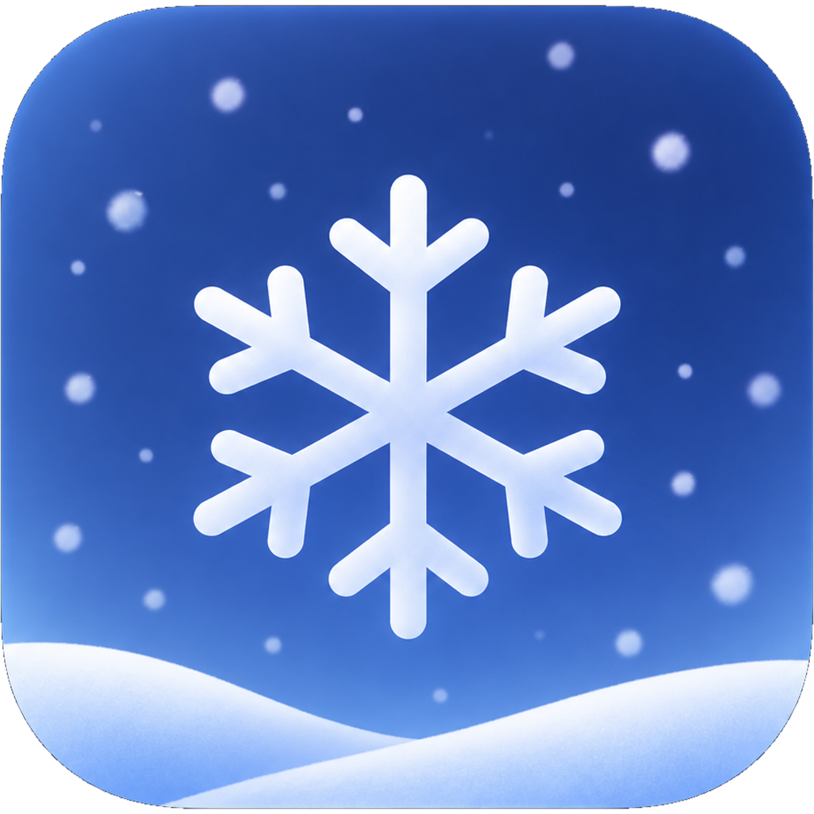
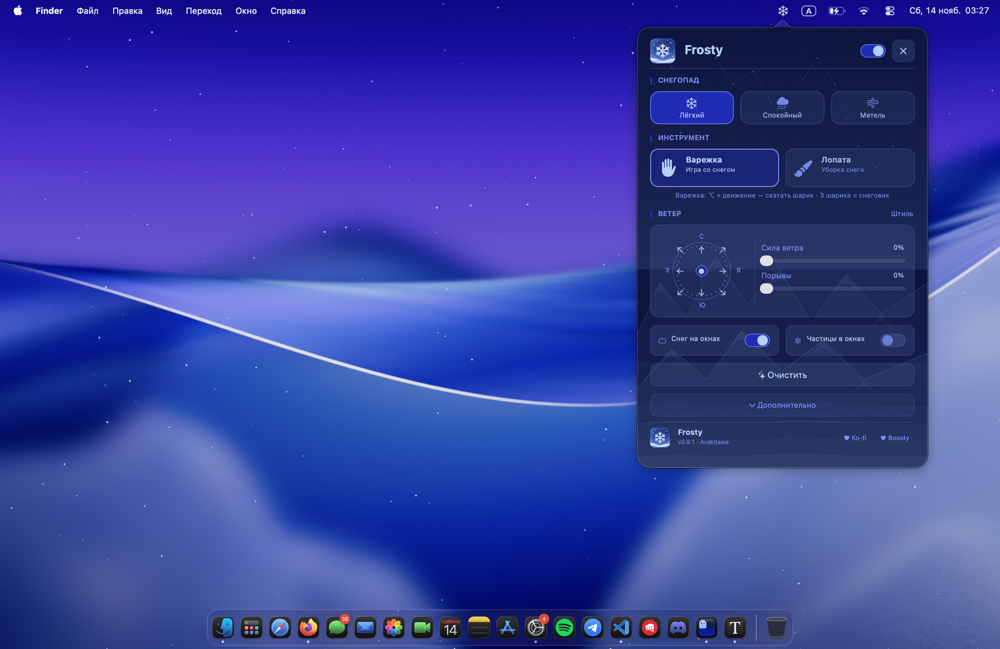
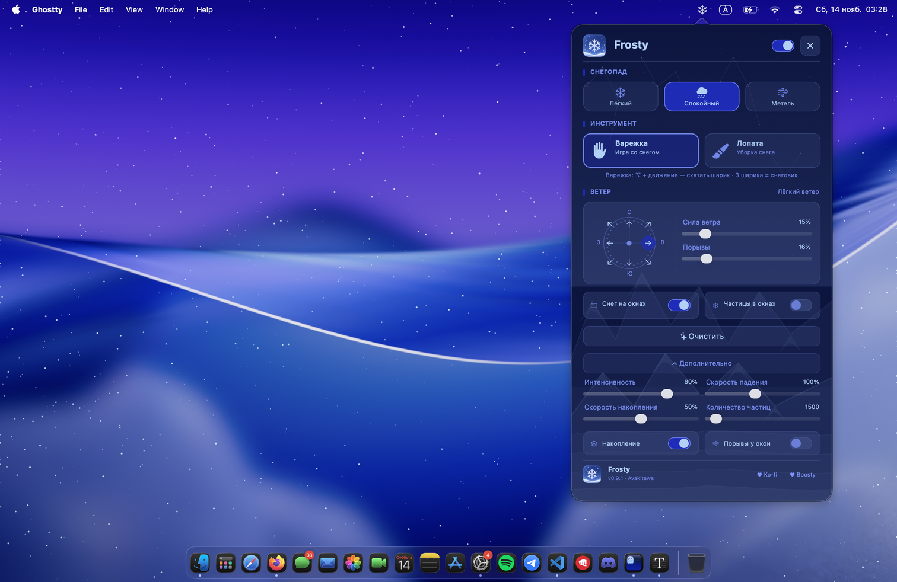
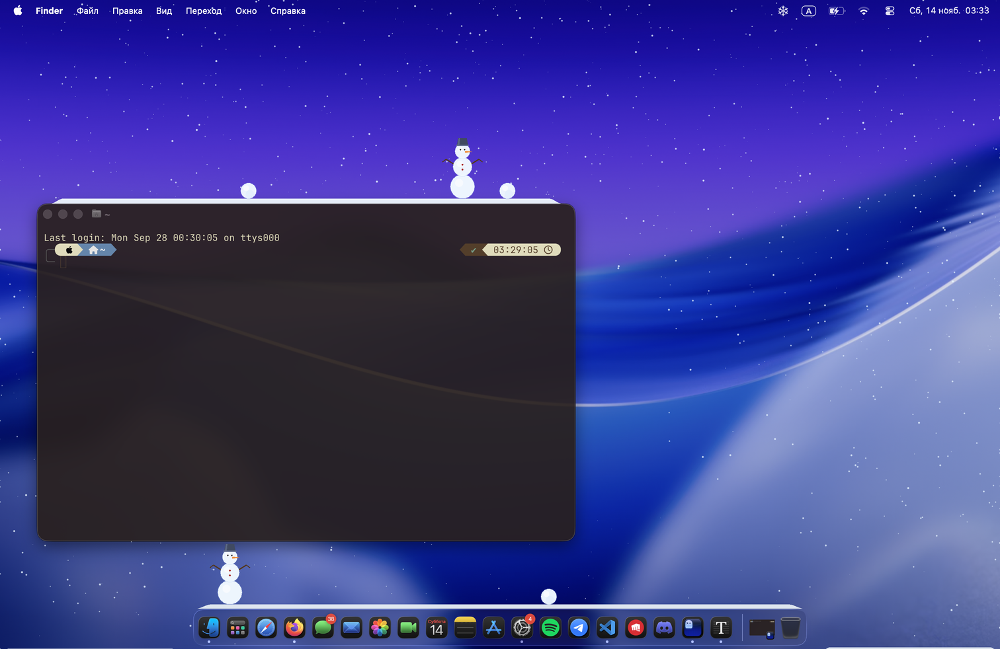
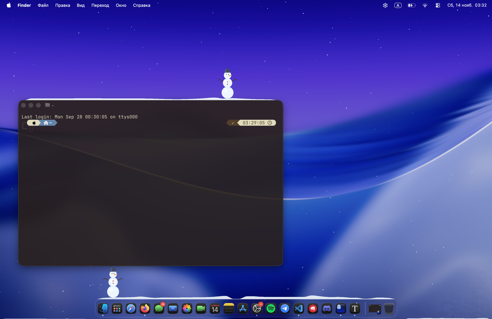
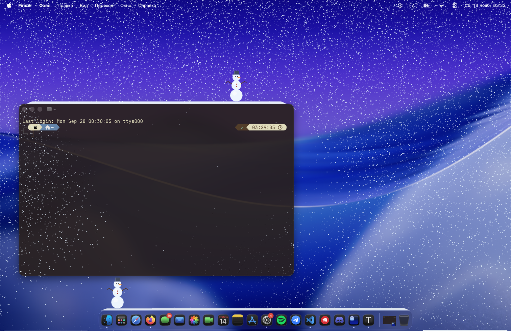
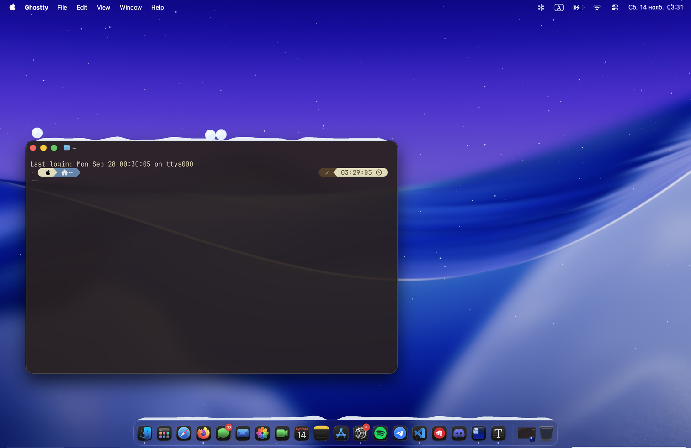

<p align="center">
  
</p>

<h1 align="center">Frosty</h1>
<p align="center">A native macOS snowfall app. Winter, without the cold.</p>

<p align="center">
  <a href="LICENSE"></a>
  
  
  <a href="https://github.com/Avakitawa/Frosty/releases/tag/v0.9.1"></a>
  <a href="https://ko-fi.com/avakitawa"></a>
  <a href="https://boosty.to/avakitawa"></a>
</p>

<p align="center">
  <a href="README.ru.md">Русский</a> ·
  <a href="https://github.com/Avakitawa/Frosty/releases/tag/v0.9.1">Download</a> ·
  <a href="https://ko-fi.com/avakitawa">Ko-fi</a> ·
  <a href="https://boosty.to/avakitawa">Boosty</a> ·
  <a href="https://github.com/Avakitawa/Frosty/issues">Report an issue</a>
</p>

Frosty is a native macOS desktop snowfall application written in Rust. It lives
in the menu bar and draws snow on transparent, click-through overlays above your
desktop. Metal renders up to 20,000 soft particles at up to 120 FPS while a
small physics engine handles wind, window tops, the Dock, snowdrifts, snowballs
and their collisions.

The app is assembled directly with AppKit and MetalKit through `objc2`; there is
no Swift, no web view and no Electron runtime. The interface follows the macOS
preferred language: Russian for `ru-*`, English for everything else. Snow is
simulated locally, and Frosty does not collect analytics or upload anything.

Created by **[Avakitawa](https://github.com/Avakitawa)**.

## Download

[Download Frosty 0.9.1 — DMG](https://github.com/Avakitawa/Frosty/releases/download/v0.9.1/Frosty-0.9.1.dmg) ·
[SHA-256](https://github.com/Avakitawa/Frosty/releases/download/v0.9.1/Frosty-0.9.1-SHA256SUMS.txt)

Open the image, drag **Frosty.app** to **Applications**, and launch it from
there. The DMG is universal (Apple Silicon + Intel) and requires macOS 13 or
newer.

This release is signed with an Apple Development certificate and is not
notarized. On another Mac, Gatekeeper may ask for confirmation on first launch;
use **Open** from the context menu or **System Settings → Privacy & Security →
Open Anyway**.

## Screenshots

Russian UI shown; the app selects Russian or English automatically from the
macOS language.

| Settings | Advanced physics |
| :---: | :---: |
| [](docs/screenshots/01.png) | [](docs/screenshots/02.png) |
| **Snow on a window** | **Window drift** |
| [](docs/screenshots/03.png) | [](docs/screenshots/04.png) |
| **Blizzard** | **Dock and window** |
| [](docs/screenshots/05.png) | [](docs/screenshots/06.png) |

## Requirements

- macOS 13.0 or newer
- Rust stable (1.82+)
- Xcode Command Line Tools with the AppKit/Metal SDK

The project is built and tested on Apple Silicon. Release packaging creates a
universal `x86_64` + `arm64` application.

## Build and run

```sh
git clone https://github.com/Avakitawa/Frosty.git
cd Frosty
cargo run -p winter-app --bin frosty
```

The binary appears in the menu bar as a snowflake. Click it to open the settings
popover, and use the unlabelled switch beside the close button to pause or resume
snowfall.

Run the checks:

```sh
cargo test --workspace
cargo clippy --workspace --all-targets
```

## Package a macOS app

```sh
rustup target add aarch64-apple-darwin x86_64-apple-darwin
./scripts/package.sh
```

The script rebuilds the icon, compiles both architectures, and produces
`dist/Frosty.app`. By default the app is ad-hoc signed; macOS may warn when it is
downloaded or copied to another Mac. For distribution, sign with a Developer ID
and optionally notarize:

```sh
SIGNING_IDENTITY="Developer ID Application: Your Name (TEAMID)" \
NOTARY_PROFILE="your-notarytool-keychain-profile" \
./scripts/package.sh
```

Create the notarization profile with `xcrun notarytool store-credentials`; keep
Apple credentials in Keychain, never in the repository.

To also build the drag-to-Applications DMG with the winter background:

```sh
SIGNING_IDENTITY="Developer ID Application: Your Name (TEAMID)" ./scripts/package-dmg.sh
```

Without `SIGNING_IDENTITY`, the DMG is ad-hoc signed.

## Controls

| Action | How |
| --- | --- |
| Open settings | Click the snowflake in the menu bar |
| Pause / resume | Toggle the switch beside the close button |
| Choose a tool | Click **Варежка** or **Лопата** in the settings panel |
| Shape the snow | Move the mitten across a drift |
| Pack a snowball | Hold **⌥ Option** and move the mitten across a drift |
| Stack snowballs | Drop three balls onto each other to build a snowman |
| Move a snowball or snowman | Drag it; release to drop |
| Clean a patch | Sweep the shovel over the snow |
| Clear everything | Press **Очистить** |

Only a deliberate drag-and-drop can connect snowballs. Ordinary collisions push
balls apart; three connected balls become a snowman with a bucket, twig arms, a
carrot nose and buttons.

## What Frosty draws

| Area | Details |
| --- | --- |
| Weather | Light, Calm and Blizzard presets, or custom intensity, fall speed, accumulation and particle count |
| Wind | Direction compass, strength and gust controls; Blizzard alternates left and right |
| Windows | Snow on exposed top edges, proportional margins, window and Dock occlusion |
| Dock | Snow along the Dock's top edge and beside bottom, left and right Docks |
| Launchpad | Snow accumulates on supported Launchpad edges |
| Tools | Mitten for sculpting and snowballs, shovel for removing snow |
| First launch | A short guide to the menu-bar icon, settings and the Option snowball gesture |
| Menu | Right-click the menu-bar icon for settings, pause, weather presets, launch at login and quit |
| Settings | Compact, no-scroll panel; physics controls live under **Дополнительно** |
| Appearance | Native dark panel in the `#091540`, `#3D518C`, `#1B2CC1`, `#7692FF` and `#ABD2FA` palette |

The simulation allocates its particle pool once, uploads geometry through
triple-buffered Metal buffers, and keeps window/dock surfaces attached while
they move. Snowfall starts at the top of the display and passes through the menu
bar; the menu bar is not a collision surface.

## Privacy

Frosty does not include telemetry, analytics, accounts or automatic network
requests. Snow and settings stay on the Mac. The Ko-fi and Boosty buttons open
their pages in the default browser only when clicked.

## Project layout

```text
app/                    AppKit/Metal app, settings panel and cursor tools
app/assets/             App icon and Metal shader
crates/winter-core/     Shared snowfall state
crates/winter-physics/  Particles, wind, drifts, snowballs and snowmen
macos/                  Info.plist and generated AppIcon.icns
scripts/                Icon generation and universal packaging
```

## Contributing

Bug reports and pull requests are welcome. Please run `cargo test --workspace`
and `cargo clippy --workspace --all-targets` before submitting changes. When
reporting a visual issue, include the macOS version and, if possible, a
screenshot or a short description of the display setup.

## Support and credits

Frosty is made by **[Avakitawa](https://github.com/Avakitawa)**.

If you enjoy the snow, you can support the project on
**[Ko-fi](https://ko-fi.com/avakitawa)** or
**[Boosty](https://boosty.to/avakitawa)**.

Thanks to the Rust, `objc2`, AppKit and Metal communities whose open-source work
makes a native app like this possible.

## License

[MIT](LICENSE) © 2026 [Avakitawa](https://github.com/Avakitawa).
