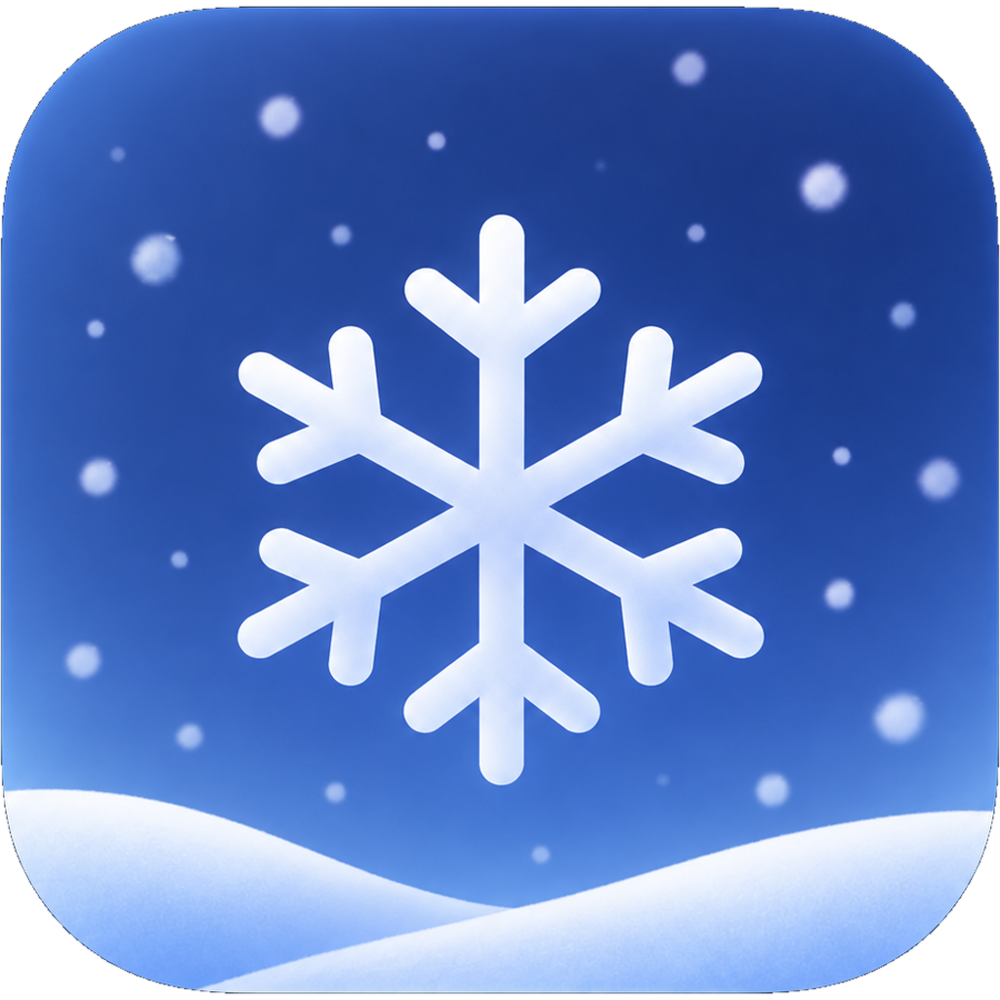

<p align="center">
  
</p>

<h1 align="center">Frosty</h1>
<p align="center">Нативный снегопад для macOS. Зима без холода.</p>

<p align="center">
  <a href="LICENSE"></a>
  
  
  
  <a href="https://ko-fi.com/avakitawa"></a>
  <a href="https://boosty.to/avakitawa"></a>
</p>

<p align="center">
  <a href="README.md">English</a> ·
  <a href="https://ko-fi.com/avakitawa">Ko-fi</a> ·
  <a href="https://boosty.to/avakitawa">Boosty</a> ·
  <a href="https://github.com/Avakitawa/Frosty/issues">Сообщить о проблеме</a>
</p>

Frosty — нативное приложение со снегопадом для macOS, написанное на Rust. Оно
живёт в строке меню и рисует снег на прозрачных overlay-окнах поверх рабочего
стола. Metal отображает до 20 000 мягких частиц с частотой до 120 FPS, а
небольшой физический движок отвечает за ветер, верхние кромки окон, Dock,
сугробы, снежки и их столкновения.

Приложение собрано напрямую на AppKit и MetalKit через `objc2`: без Swift, без
WebView и без Electron. Снег считается локально — Frosty не собирает аналитику
и ничего не отправляет в сеть.

Автор — **[Avakitawa](https://github.com/Avakitawa)**.

## Требования

- macOS 13.0 или новее
- Rust stable (1.82+)
- Xcode Command Line Tools с AppKit/Metal SDK

Проект собирается и тестируется на Apple Silicon. Скрипт упаковки создаёт
универсальное приложение `x86_64` + `arm64`.

## Сборка и запуск

```sh
git clone https://github.com/Avakitawa/Frosty.git
cd Frosty
cargo run -p winter-app --bin frosty
```

В строке меню появится снежинка. Нажми её, чтобы открыть настройки, а
переключатель рядом с кнопкой закрытия ставит снегопад на паузу.

Проверки:

```sh
cargo test --workspace
cargo clippy --workspace --all-targets
```

## Сборка .app

```sh
rustup target add aarch64-apple-darwin x86_64-apple-darwin
./scripts/package.sh
```

Скрипт пересобирает иконку, компилирует обе архитектуры и создаёт
`dist/Frosty.app`. По умолчанию приложение подписано ad-hoc; при переносе на
другой Mac Gatekeeper может предупредить. Для распространения подпиши
Developer ID и при необходимости нотаризуй:

```sh
SIGNING_IDENTITY="Developer ID Application: Your Name (TEAMID)" \
NOTARY_PROFILE="your-notarytool-keychain-profile" \
./scripts/package.sh
```

Профиль для нотаризации создаётся через `xcrun notarytool store-credentials`.
Пароли Apple храни только в Keychain.

## Управление

| Действие | Как |
| --- | --- |
| Открыть настройки | Нажать снежинку в строке меню |
| Пауза / продолжить | Переключатель рядом с крестиком |
| Выбрать инструмент | **Варежка** или **Лопата** в панели |
| Лепить сугроб | Двигать варежкой по снегу |
| Скатать снежок | Зажать **⌥ Option** и двинуть варежкой по сугробу |
| Собрать снеговика | Положить три снежка друг на друга |
| Двигать снежок/снеговика | Перетащить и отпустить |
| Убрать снег | Провести лопатой |
| Очистить всё | Кнопка **Очистить** |

Снежки соединяются только при осознанном перетаскивании и отпускании. Обычные
столкновения расталкивают их; три соединённых снежка превращаются в снеговика
с ведром, ветками, морковкой и пуговицами.

## Что умеет Frosty

| Раздел | Возможности |
| --- | --- |
| Погода | Пресеты «Лёгкий», «Спокойный», «Метель» или ручные интенсивность, скорость падения, накопление и число частиц |
| Ветер | Компас направления, сила и порывы; у «Метели» ветер чередует стороны |
| Окна | Снег на открытых верхних кромках, отступы от краёв, перекрытие окнами и Dock |
| Dock | Снег на верхней кромке, по бокам нижнего Dock и на внутренней стороне бокового |
| Launchpad | Снег на поддерживаемых кромках Launchpad |
| Инструменты | Варежка для лепки и снежков, лопата для уборки |
| Настройки | Компактная панель без скролла; физика — в разделе **Дополнительно** |
| Оформление | Тёмная панель в палитре `#091540`, `#3D518C`, `#1B2CC1`, `#7692FF`, `#ABD2FA` |

Пул частиц выделяется один раз, геометрия загружается через тройную буферизацию
Metal, а поверхности окон и Dock следуют за ними при перемещении. Снег
начинается у верхней границы экрана и проходит сквозь строку меню; строка меню
не является поверхностью столкновения.

## Приватность

В Frosty нет телеметрии, аналитики, аккаунтов и автоматических сетевых
запросов. Снег и настройки остаются на Mac. Кнопки Ko-fi и Boosty открывают
страницы в браузере только по нажатию.

## Структура проекта

```text
app/                    AppKit/Metal-приложение, панель настроек и инструменты
app/assets/             Иконка приложения и Metal-шейдер
crates/winter-core/     Общее состояние снегопада
crates/winter-physics/  Частицы, ветер, сугробы, снежки и снеговики
macos/                  Info.plist и сгенерированный AppIcon.icns
scripts/                Генерация иконки и универсальная упаковка
```

## Участие

Issues и pull requests приветствуются. Перед изменениями запусти
`cargo test --workspace` и `cargo clippy --workspace --all-targets`. В багрепорте
укажи версию macOS и, если возможно, скриншот или описание конфигурации
дисплеев.

## Поддержка

Frosty делает **[Avakitawa](https://github.com/Avakitawa)**.

Если нравится снег, проект можно поддержать на
**[Ko-fi](https://ko-fi.com/avakitawa)** или
**[Boosty](https://boosty.to/avakitawa)**.

Спасибо сообществам Rust, `objc2`, AppKit и Metal за открытые инструменты, на
которых держится приложение.

## Лицензия

[MIT](LICENSE) © 2026 [Avakitawa](https://github.com/Avakitawa).
